# 🚗 여기좋아 — 렌터카 예약 파트

> Flutter + Spring Boot 기반 국내 여행 통합 예약 앱 (팀 프로젝트)
> 이 브랜치(`taeheun`)는 **오태흔**이 맡은 **렌터카 검색 · 예약** 기능(**Flutter 앱 + Spring Boot API**)을 중심으로 정리한 문서입니다.

- **기간**: 2026.04.13 \~ 2026.04.24 (약 2주)
- **인원**: 7명 (숙소 · 항공 · 렌터카 · 패키지 · 회원/커뮤니티 분담)
- **담당**
  - **Frontend**: 렌터카 지역·날짜 검색, 날짜·시간 범위 달력, 차량 목록 커서 페이징, 차량 예약 · 로그인 후 재시도, 내 렌터카 예약 내역 · 취소, API 클라이언트 env 설정, 로그인 상태 갱신
  - **Backend**: 공공데이터 렌트카 수집, 기간 겹침 제외 차량 검색, 커서 페이지네이션, 예약 생성 검증 · 취소, JWT 인증 연동 → [🖥 백엔드 섹션](#backend)

---

<a id="screens"></a>

## 🖼 화면

### 렌터카 홈 · 달력

| 지역 · 날짜 선택 | 날짜 · 시간 범위 선택 |
|:---:|:---:|
| 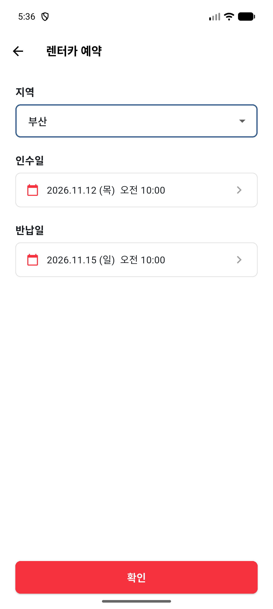 | 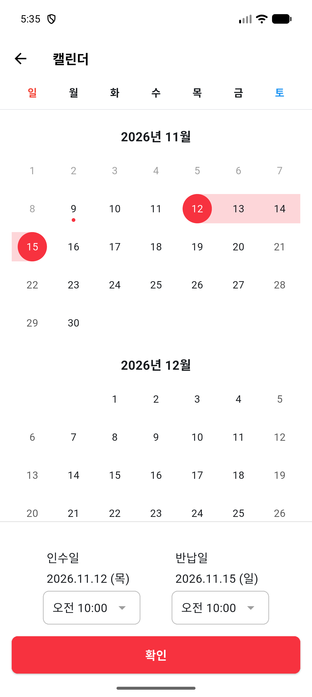 |
| 대여 지역과 대여 기간을 선택 | 시작일\~종료일 **범위 선택** + 오전 8시\~오후 8시 **30분 단위 시간 선택** |

> 🔗 API: [`GET /car/regions`](#api-spec)

### 차량 목록

| 로딩 (Shimmer) | 차량 목록 (무한 스크롤) | 업체 선택 |
|:---:|:---:|:---:|
| 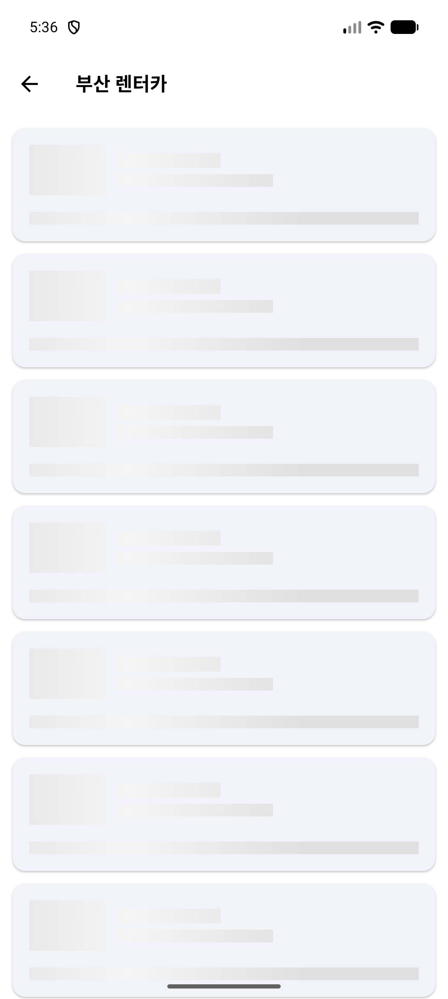 | 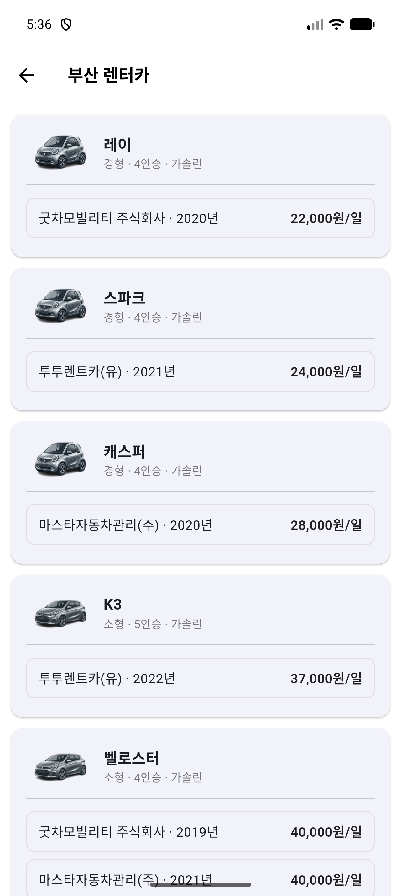 | 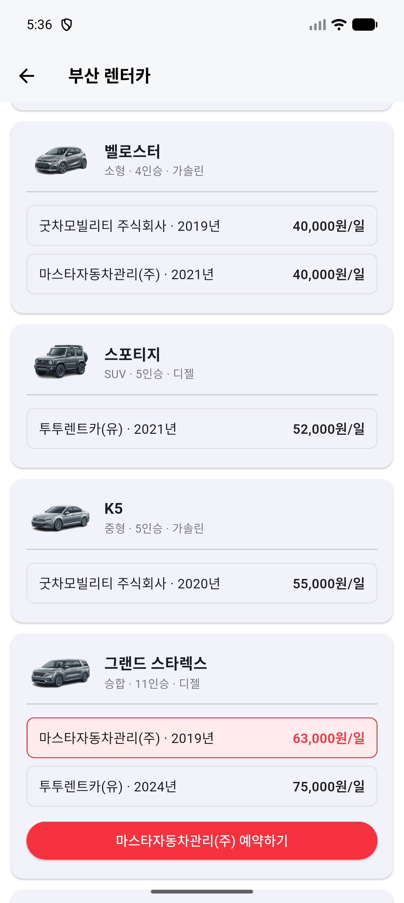 |
| 데이터를 받아오는 동안 **Shimmer** 스켈레톤 카드 표시 | 차종별 **최저가 순** 정렬, 하단 도달 시 다음 페이지를 **커서 기반**으로 불러옴 | 차종 카드 안에서 업체를 고르면 **선택 표시 + 예약하기 버튼** 노출 (업체가 많으면 **더보기 / 닫기**) |

> 🔗 API: [`GET /car/search/all`](#api-spec) — 예약이 겹치는 차량 제외, 차종별 최저가 + 업체별 차량을 한 번에 응답 ([검색 흐름](#search-flow))

### 예약

| 예약 확인 | 미로그인 → 로그인 → 자동 재시도 |
|:---:|:---:|
| 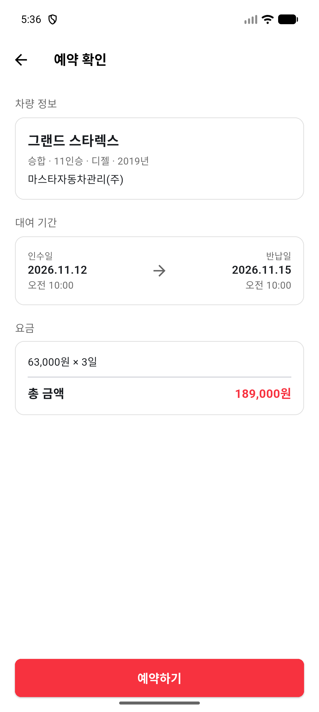 | 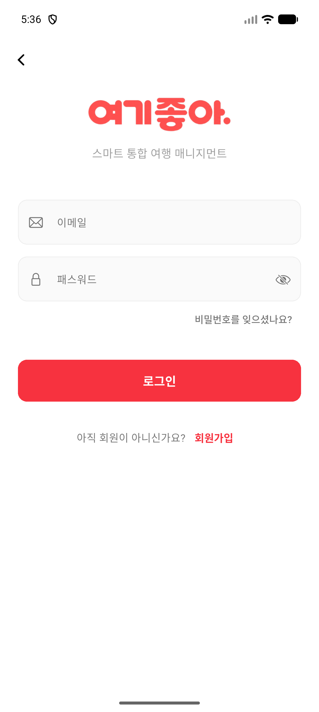 |
| 차량 · 업체 · 대여 기간 확인, **일일 요금 × 대여일수**로 총 금액 표시 | 토큰이 없거나 만료돼 `401`을 받으면 로그인 화면으로 이동, 로그인에 성공하면 **원래 예약을 자동으로 다시 요청** |

> 🔗 API: [`POST /api/car/reservation`](#api-spec) — 기간 중복 · 금액 계산은 서버에서 검증 ([예약 검증 흐름](#reserve-flow))

---

## 🛠 사용 기술 (Frontend)

| 구분 | 기술 |
|------|------|
| Frontend | Flutter, Dart |
| 상태 관리 | **Provider** (ChangeNotifier) |
| 네트워크 | **Dio** (인증용 / 비인증용 인스턴스 분리, 토큰 인터셉터) |
| 저장소 | flutter_secure_storage (토큰 보관) |
| UI | table_calendar, shimmer, intl |
| 설정 | flutter_dotenv (`.env`로 서버 주소 관리) |
| Backend | Spring Boot 3.5 → [백엔드 사용 기술](#backend) |
| 기타 | Git / GitHub |

---

## ✨ 담당 기능 (Frontend)

### 1. 레이어 구조 설계
- `Screen → Controller → Service → API` 계층으로 분리
- 화면은 그리기만 담당하고, 상태는 `ChangeNotifier` Controller가, API 호출은 Service가 담당
- Service는 `({data, error})` **Record 타입**으로 결과를 반환 → Controller에서 try-catch 없이 성공/실패를 분기

### 2. 날짜 · 시간 범위 달력
- `table_calendar` 기반 범위 선택: 시작일보다 이전 날짜를 누르면 시작일을 다시 설정
- 대여 시간 목록(오전 8:00 \~ 오후 8:00, 30분 단위)을 컬렉션 for / if로 생성
- `saveState()` / `restoreState()`: 달력에서 **확인 없이 뒤로가기**하면 선택하기 전의 상태로 되돌림

### 3. 차량 목록 커서 페이징
- `가격 + 차량명` **복합 커서**로 다음 페이지 요청 (offset 방식의 중복·누락 문제 방지)
- `ScrollController`로 하단 200px 이내에 도달하면 다음 페이지를 미리 요청
- `isLoading` / `hasNext` 체크로 **중복 요청 차단**
- 서버가 내려준 `nextCursorPrice` · `nextCursorName`을 그대로 다음 요청에 사용 → [커서 처리(백엔드)](#backend-cursor)
- 로딩 중에는 Shimmer 카드, 마지막 인덱스에는 다음 페이지용 Shimmer 자리를 표시

### 4. 예약 · 인증 흐름
- 인증이 필요한 예약 API는 토큰 인터셉터가 붙은 `dio`, 지역·차량 조회는 `publicDio`로 분리
- 401/403 응답 → "로그인이 필요합니다." → 로그인 화면을 `arguments: 'returnToPage'`로 호출
- 로그인 화면은 인자가 있으면 메인으로 가지 않고 `pop(true)`로 돌아옴 → **예약 자동 재시도**
- 예약 완료 후 `popUntil(isFirst)`로 쌓인 화면을 정리하고 홈으로 이동

### 5. 내 렌터카 예약 내역
- `상태 순서 + 시작일 + id` 3중 커서로 페이징 (서버 응답의 다음 커서를 그대로 전달 → [커서 처리(백엔드)](#backend-cursor))
- 예약 취소 성공 시 목록을 다시 불러오지 않고 로컬 리스트에서 바로 제거

### 6. 공통 작업
- 서버 주소를 코드에 하드코딩하지 않고 `.env`의 `BASE_URL`을 읽도록 변경 (`.gitignore`에 env 추가)
- `RouteObserver` + `RouteAware`(`didPopNext`)로 메인 화면에 돌아올 때마다 **로그인 상태 다시 확인**
- 초기 라우팅 · 스플래시 화면 구성

---

## 🔄 화면 흐름

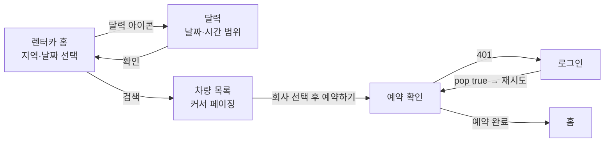

## 🏗 레이어 구조

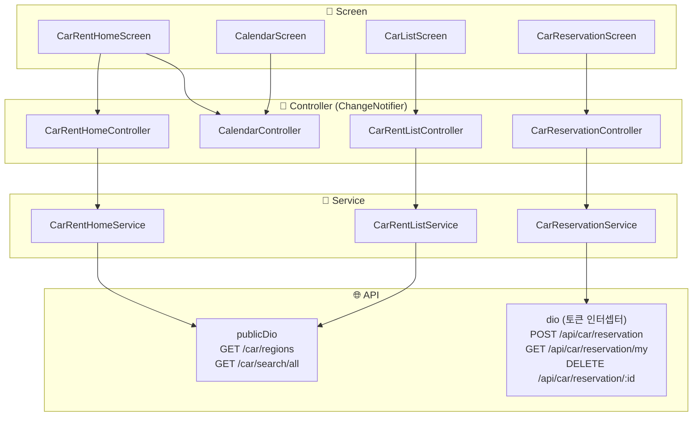

> 🌐 API 계층의 요청 / 응답 형식은 [📡 API 명세](#api-spec) 참고

---

## 🐛 트러블슈팅 (Frontend)

| 문제 | 원인 | 해결 |
|------|------|------|
| 로그인 후 메인으로 돌아와도 비로그인 상태로 보임 | 메인 화면이 `initState`에서만 로그인 상태를 확인 | `RouteAware.didPopNext`에서 다시 확인 |
| 예약 중 로그인하면 예약 화면으로 돌아오지 않음 | 로그인 성공 시 항상 메인으로 이동 | 로그인 화면에 호출 출처 인자를 넘기고 `pop(true)` 후 예약 재시도 |
| 차량명이 길면 카드가 오른쪽으로 잘림 | `Row` 안의 `Column`이 남은 너비를 넘어감 | `Expanded`로 감싸 너비 제한 |

---

## 📂 담당 주요 파일 (Frontend)

| 계층 | 파일 |
|------|------|
| Screen | `car_rent_home_screen.dart`, `calendar_screen.dart`, `car_list_screen.dart`, `car_reservation_screen.dart` |
| Controller | `car_rent_home_controller.dart`, `calendar_controller.dart`, `car_rent_list_controller.dart`, `car_reservation_controller.dart` |
| Service | `car_rent_home_service.dart`, `car_rent_list_service.dart`, `car_reservation_service.dart` |
| Model | `car_search_cursor_*`, `car_reservation_cursor_*`, `car_rental_reservation_dto.dart`, `company_car_dto.dart` |
| 공통 | `util/api_client.dart` (env 적용), `screen/RoutingScreen.dart`, `screen/SplashScreen.dart`, `screen/MainScreen.dart` (로그인 상태 갱신) |

> 📖 커서 페이징 시퀀스, 예약 생성 분기, 달력 선택 로직 상세는 **[car_feature.md](car_feature.md)** 참고

---

<a id="backend"></a>

## 🖥 백엔드 (Spring Boot) — 렌트카 파트

> 앱의 **렌트카 검색 · 예약 · 내 예약 목록** 기능을 담당하는 REST API 서버
> 백엔드 레포 브랜치: `taeheun` / 상세 문서: `back_spring_car.md`

### 🛠 사용 기술 (Backend)

| 구분 | 기술 |
|------|------|
| Backend | Java 17, Spring Boot 3.5 |
| ORM / Query | Spring Data JPA (Hibernate), **QueryDSL 5.0** |
| 인증 | Spring Security + **JWT** (jjwt 0.11.5) — Access / Refresh Token |
| 외부 API | **공공데이터포털 전국렌터카업체 표준데이터** (RestTemplate + Gson) |
| Database | MariaDB |
| 기타 | Lombok, JUnit 5, Gradle |

### ✨ 담당 기능 (Backend)

#### 1. 렌트카 데이터 수집
- 공공데이터 API에서 렌트카 업체(업체명 · 주소 · 위도/경도 · 전화번호)를 1,000건 단위로 페이징 호출해 수집
- 지역명 정규화: `부산광역시 → 부산`, `경상남도 → 경남`처럼 줄여서 저장해 **지역 필터에 바로 사용**
- 주소 중복 제거 후 지역별 일부만 저장, 업체마다 **차량 1\~5대**를 25개 차종 스펙(경형 · 소형 · 중형 · 대형 · SUV · 승합 · 전기)으로 생성 (가격은 1,000원 단위)

#### 2. 차량 검색 (지역 + 대여 기간)
- 선택한 기간에 **예약이 겹치는 차량은 제외**하고 검색
- 차량을 **차종(이름 · 타입 · 좌석 · 연료)으로 GROUP BY**해 **최저가**와 함께 반환하고, 차종마다 **업체별 차량 목록**을 같이 반환 → 앱의 [차량 목록 · 회사별 옵션 화면](#screens)
- **쿼리 2번**으로 처리: ① 차종 목록(집계) ② 차종 이름 `IN` 절 + 업체 `fetchJoin`으로 업체 차량 일괄 조회 → 차종별 N+1 방지

<a id="backend-cursor"></a>

#### 3. 커서 기반 페이지네이션 (무한 스크롤)
- 차종 목록: `(최저가 ASC, 차종명 ASC)` **복합 커서**로 가격이 같은 차종도 빠짐없이 다음 페이지로 이어짐
- 내 예약 목록: `(시작일 DESC, 상태 순서, id ASC)` 3단 커서
- `size + 1`개를 조회해서 `hasNext`를 판단 → 데이터가 size의 배수일 때 빈 페이지를 한 번 더 요청하는 문제 방지

#### 4. 예약 생성 · 취소
- 예약 생성 시 검증: 반납 시간 > 대여 시간 / 차량 존재 / **같은 차량 기간 중복** / **같은 회원의 기간 중복**(한 사람이 같은 시간에 두 대 예약 불가)
- 총 금액은 서버에서 계산: `일일 가격 × ceil(대여 시간 / 24h)` (최소 1일)
- 취소는 **본인 예약만** 가능

#### 5. 인증
- `/generateToken`에 `mid`, `mpw`로 로그인 → Access / Refresh Token 발급
- `/api/**` 요청은 `TokenCheckFilter`에서 `Authorization: Bearer {accessToken}` 검증
- 차량 검색(`/car/**`)은 비로그인도 가능, 예약(`/api/car/reservation/**`)은 토큰 필요 → 앱에서 `publicDio` / `dio`로 나눈 이유

<a id="api-spec"></a>

### 📡 API 명세

| 기능 | Method | URL | 인증 | 사용 화면 |
|------|--------|-----|:---:|------|
| 지역 목록 | GET | `/car/regions` | ❌ | 렌터카 홈 |
| 차량 검색 (차종 + 업체 차량) | GET | `/car/search/all` | ❌ | 차량 목록 |
| 예약 생성 | POST | `/api/car/reservation` | ✅ | 예약 확인 |
| 내 예약 목록 | GET | `/api/car/reservation/my` | ✅ | 내 예약 내역 |
| 예약 취소 | DELETE | `/api/car/reservation/{id}` | ✅ | 내 예약 내역 |

<details>
<summary>요청 / 응답 예시</summary>

**차량 검색**
```
GET /car/search/all?region=부산&startDate=2025-05-01&endDate=2025-05-05&cursorPrice=0&cursorName=&size=10
```
```json
{
  "content": [
    {
      "carName": "모닝", "type": "경형", "seats": 4, "fuel": "가솔린",
      "lowestPrice": 21000,
      "companyCarDTOs": [
        { "carId": 12, "companyName": "OO렌트카", "year": 2022, "dailyPrice": 21000 }
      ]
    }
  ],
  "hasNext": true,
  "nextCursorPrice": 21000,
  "nextCursorName": "모닝"
}
```
> 다음 페이지: `nextCursorPrice`, `nextCursorName`을 그대로 `cursorPrice`, `cursorName`에 넣어서 요청

**예약 생성**
```json
POST /api/car/reservation
{ "carId": 12, "startDate": "2025-05-01T10:00:00", "endDate": "2025-05-03T10:00:00" }
```
```json
{
  "id": 5, "carId": 12, "carName": "모닝", "companyName": "OO렌트카",
  "userId": "user1", "startDate": "2025-05-01T10:00:00", "endDate": "2025-05-03T10:00:00",
  "status": "CONFIRMED", "totalPrice": 42000, "createdAt": "..."
}
```
> 실패 시 `400` + 메시지 (예: `해당 시간에 이미 예약된 차량입니다.`) → 앱에서 SnackBar로 표시
> `401` / `403`이면 앱이 로그인 화면으로 이동 후 재시도

**내 예약 목록**
```
GET /api/car/reservation/my?size=10
GET /api/car/reservation/my?cursorStatusOrder=0&cursorStartDate=2025-05-10T00:00:00&cursorId=5&size=10
```
```json
{ "reservation": [ ... ], "hasNext": true,
  "nextCursorStatusOrder": 0, "nextCursorStartDate": "2025-05-10T00:00", "nextCursorId": 5 }
```
</details>

<a id="search-flow"></a>

### 🔍 차량 검색 흐름

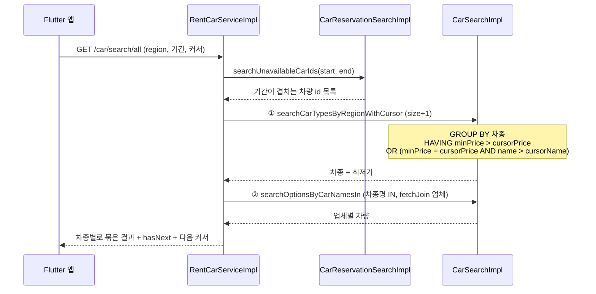

<a id="reserve-flow"></a>

### 📝 예약 생성 검증 흐름

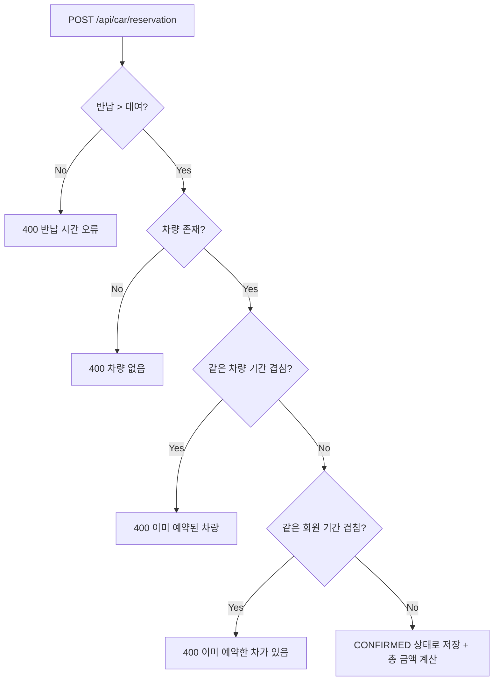

### 🗄 DB 관계 (담당 기능 관련)

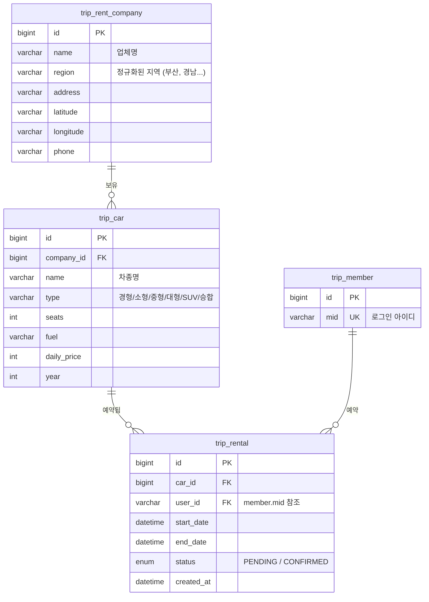

- **차 1대 = `trip_car` 1행**이라 같은 차종이 업체마다 여러 행 존재 → 검색 시 차종으로 묶어서 반환
- `trip_rental.user_id`는 회원 PK가 아니라 **`mid`(로그인 아이디)를 참조**

<a id="backend-trouble"></a>

### 🐛 트러블슈팅 (Backend)

| 문제 | 원인 | 해결 |
|------|------|------|
| 가격이 같은 차종이 다음 페이지에서 누락 | 가격 하나만 커서로 사용 | `(가격, 차종명)` **복합 커서**로 변경 |
| 마지막 페이지에서 빈 요청이 한 번 더 발생 | `결과 수 == size`로 `hasNext` 판단 | `size + 1`개 조회 후 초과 여부로 판단 |
| 차종마다 업체 차량을 따로 조회 (N+1) | 차종 루프 안에서 개별 조회 | 차종명 `IN` 절 + `fetchJoin`으로 **쿼리 2번에 처리** |
| 한 회원이 같은 시간에 여러 대 예약 가능 | 차량 기준 중복만 체크 | **회원 기준 기간 중복 체크** 추가 |
| 지역 필터 값이 제각각 (`부산광역시`, `부산시`...) | 공공데이터 원본 지역명 사용 | 저장할 때 **지역명 정규화** |

### 📂 담당 주요 파일 (Backend)

| 계층 | 파일 |
|------|------|
| Controller | `RentCarController`, `CarReservationController` |
| Service | `RentCarServiceImpl`, `RentalServiceImpl`, `RentCarDataService` (공공데이터 적재) |
| Repository | `CarSearchImpl`, `CarReservationSearchImpl`, `RentCarCompanySearchImpl` (QueryDSL) |
| Security | `TokenCheckFilter`, `CustomSecurityConfig` |
| Test | `CarRepositotyTests`, `CarReservationRepositoryTests`, `RentCarServiceTests`, `RentalServiceTests` |

---

## 🏛 프로젝트 전체 기능 (팀)

회원가입 · 로그인 · 숙소 · 항공 · 렌터카 · 패키지 예약 · 내 예약 · 찜 · 리뷰 · 커뮤니티 · 공지사항 · 1:1 문의 · 통합 검색

---

## ▶ 실행 방법

### 백엔드

```bash
# 1. MariaDB 준비 후 application.properties의 DB 정보 + public.api.rent.serviceKey 설정
# 2. 실행
./gradlew bootRun
```

### 앱

```bash
# 1. 프로젝트 루트에 .env 생성 (백엔드 서버 주소)
echo "BASE_URL=http://<서버IP>:8080" > .env
# 2. 패키지 설치 후 실행
flutter pub get
flutter run
```
